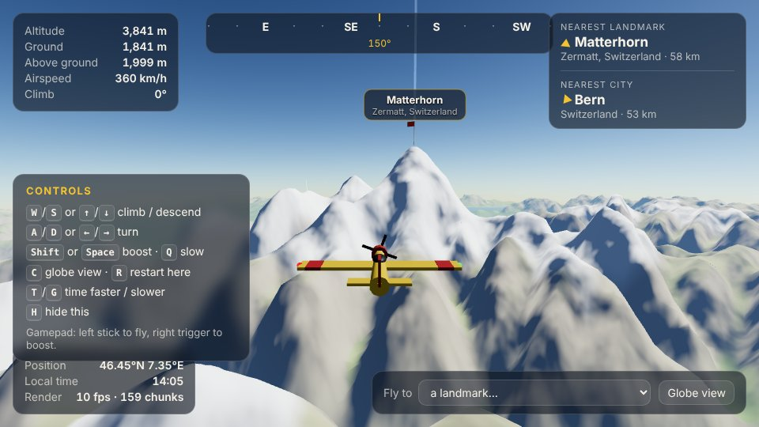
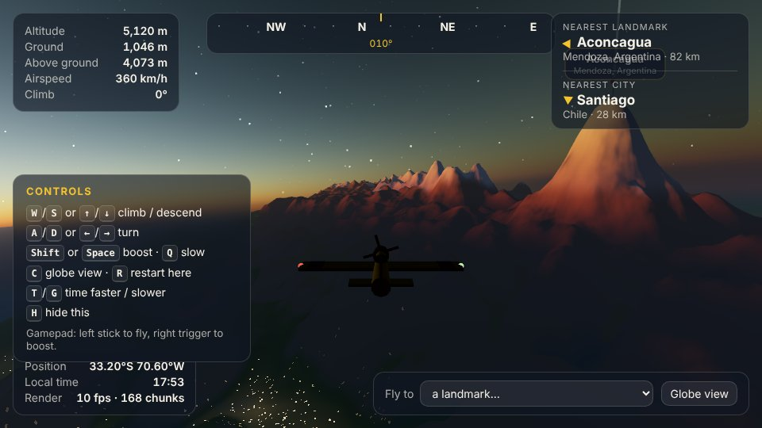
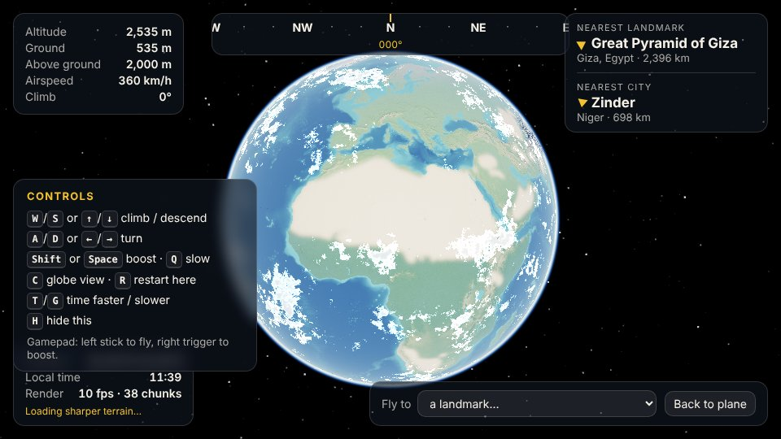

# Postmark

A cozy airmail flying game on a real Earth. Start a one-plane mail company in your hometown, fly letters
across real mountains, coastlines and lakes, and grow it across a century of flight.

**Status:** prototype, milestone 1.5 (sharper Earth: ETOPO 2022 terrain streaming and clouds). See [docs/milestones.md](docs/milestones.md).

| | |
| --- | --- |
|  |  |
|  |  |

## Run it

Requires Node 20.9+ and pnpm 10.

```bash
pnpm install
pnpm dev          # http://localhost:3000, then click "Take off"
```

Controls: **W/S** climb and descend · **A/D** turn · **Shift** or **Space** boost · **Q** slow ·
**C** globe view · **R** restart · **T/G** time of day faster or slower · **H** help. Gamepads work too.

## Repository

| Path | What |
| --- | --- |
| `apps/web` | Next.js site and the `/play` page |
| `packages/game-core` | Game logic: world scale, geo math, flight model (unit-tested) |
| `packages/globe` | three.js renderer: terrain, atmosphere, plane, landmarks |
| `tools/geo-pipeline` | Bakes real elevation, coastlines, lakes, rivers, cities into `apps/web/public/geo` |
| `docs/` | [architecture](docs/architecture.md), [geographic data and elevation](docs/geodata.md), [Blender pipeline](docs/blender-pipeline.md), [milestones](docs/milestones.md) |

```bash
pnpm test         # unit tests
pnpm typecheck
pnpm build
pnpm geo:fetch && pnpm geo:bake   # rebuild the geo data (needs Python, see tools/geo-pipeline)
```

## Data credits

Elevation and bathymetry: ETOPO 2022 (and ETOPO1 as a fallback), NOAA National Centers for Environmental Information (public domain).
Coastlines, lakes, rivers, ice, cities: [Natural Earth](https://www.naturalearthdata.com) (public domain).
