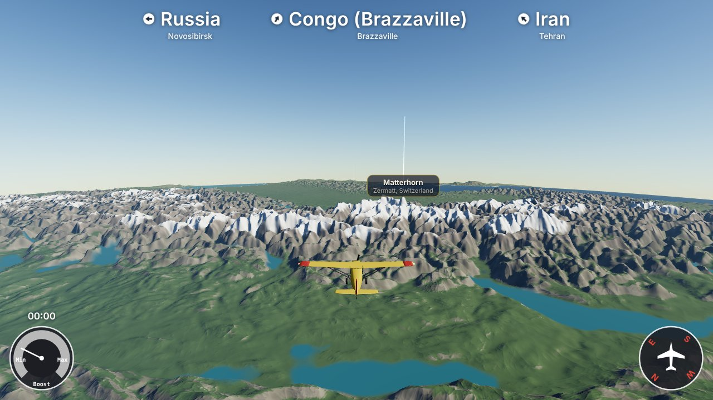
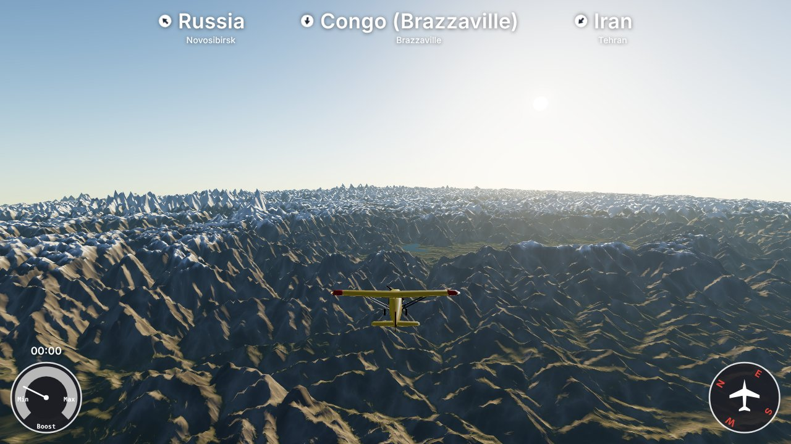
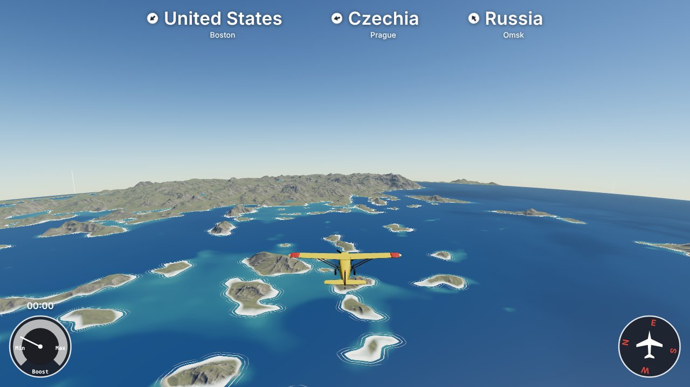
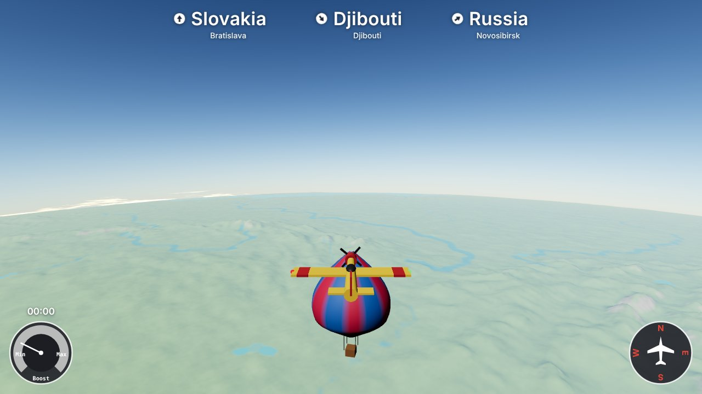

# Postmark

A cozy airmail flying game on a real Earth. Start a one-plane mail company in your hometown, fly letters
across real mountains, coastlines and lakes, and grow it across a century of flight.

**Status:** prototype: real-Earth terrain (ETOPO 2022 everywhere, GEBCO ~610 m in 10 mountain regions), a Geographical Adventures-style flight UI, the first delivery loop, and Blender-made plane, parcel and balloons. See [docs/milestones.md](docs/milestones.md).

| | |
| --- | --- |
|  |  |
|  |  |

## Run it

Requires Node 20.9+ and pnpm 10.

```bash
pnpm install
pnpm dev          # http://localhost:3000, then click "Take off"
```

If the page sits on "Warming up the engine…", the browser isn't getting the game's scripts. The dev
server only serves them to loopback (`localhost`, `127.0.0.1`) and private-network addresses; for any
other host name, start it with `POSTMARK_DEV_ORIGINS=my-host pnpm dev`. Also make sure you are on the
latest branch and have run `pnpm install` after pulling.

Fly to the destinations shown at the top (the arrows point the way), find the hot-air balloon over the
city, and drop a parcel by parachute close to it.

Controls: **W/S** climb and descend · **A/D** turn · **Shift** boost · **Space** drop a parcel · **Q** slow ·
**R** restart · **T/G** time of day faster or slower · **H** controls hint · **`** developer overlay.
Gamepad: left stick to fly, right trigger to boost, A to drop.

## Repository

| Path | What |
| --- | --- |
| `apps/web` | Next.js site and the `/play` page |
| `packages/game-core` | Game logic: world scale, geo math, flight model (unit-tested) |
| `packages/globe` | three.js renderer: terrain, atmosphere, plane, balloons, parcels |
| `tools/geo-pipeline` | Bakes real elevation, coastlines, lakes, rivers, cities into `apps/web/public/geo` |
| `docs/` | [architecture](docs/architecture.md), [geographic data and elevation](docs/geodata.md), [Blender pipeline](docs/blender-pipeline.md), [milestones](docs/milestones.md) |

```bash
pnpm test         # unit tests
pnpm typecheck
pnpm build
pnpm geo:fetch && pnpm geo:bake   # rebuild the geo data (needs Python, see tools/geo-pipeline)
```

## Data credits

Elevation and bathymetry: ETOPO 2022 (and ETOPO1 as a fallback), NOAA National Centers for Environmental Information (public domain);
fine terrain: GEBCO Compilation Group (2026) GEBCO 2026 Grid.
Coastlines, lakes, rivers, ice, cities: [Natural Earth](https://www.naturalearthdata.com) (public domain).
